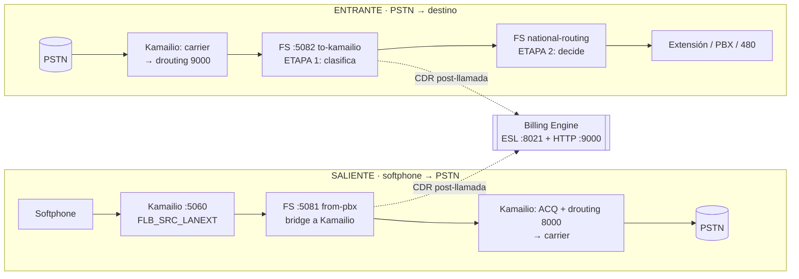
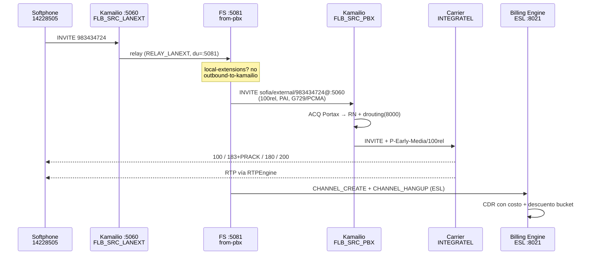
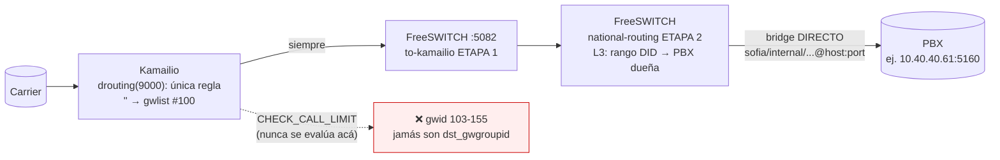
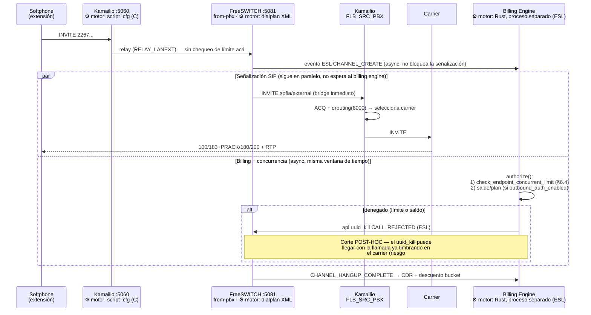

# PRD — Flujo End-to-End de Llamadas + Billing (Autorización y CDR)

**Sistema:** ApoloBilling SBC (Kamailio 5.8 + FreeSWITCH 1.10 + RTPEngine + Billing Engine)
**Versión:** 1.1 — estado verificado en producción (`sbc-core-01`)
**Fecha:** 2026-10-21 (v1.0: 2026-10-14)
**Alcance:** una llamada completa en cada dirección, paso a paso, indicando en
qué pasos hay autorización billing, CDR, **y control de canales/llamadas
simultáneas por endpoint** (§6-7, nuevo en esta versión). Basado en trazas
reales (`14228505 → 983434724`, `938391839 → 672217402000`), logs y archivos
vivos.

> **Changelog v1.1:** se implementó y verificó en producción el enforcement
> real de `max_concurrent_calls` para los tres tipos de endpoint
> (extensión, troncal credentials, troncal IP). El hallazgo central: el
> mecanismo de Kamailio (`CHECK_CALL_LIMIT`) que ya existía para troncales IP
> **nunca estuvo en el camino real** de las llamadas entrantes a esas PBX
> (bridge directo FreeSWITCH→PBX, sin pasar por Kamailio) — se agregó
> enforcement nativo de FreeSWITCH (`mod_hash`/`limit`) en el punto real.
> Detalle completo en §6.

> Convención: los fragmentos `kamailio.cfg` / `from-pbx.xml` /
> `to-kamailio.xml` son copias literales de producción. Los diagramas están en
> Mermaid (los renderan GitHub/GitLab/VS Code).

---

## 1. Mapa de un vistazo



### Matriz autorización / CDR (estado actual)

| Flujo | Pre-autorización | CDR | Descuento |
|---|---|---|---|
| Saliente | ❌ eliminada 2026-10-14 (bloque `system`/`system_result` roto: mataba el 100%) | ✅ ESL `CHANNEL_CREATE`/`HANGUP` → CDR con costo | ✅ post-llamada (bucket) |
| Entrante normal | ❌ por diseño (paga la red origen) | ✅ CDR costo $0.0 | — |
| Entrante toll-free 0800/1800 | lookup del dueño (paga el llamado) | ✅ CDR con costo al llamado | ✅ |

---

## 2. Flujo SALIENTE (softphone → PSTN)

### 2.1 Diagrama de secuencia (traza real 08:28:38, `14228505 → 983434724`)



### 2.2 Kamailio: relay LAN → FS (`kamailio.cfg:1950`)

```kamailio
route[RELAY_LANEXT] {
	$du = "sip:INTERNAL_IP_ADDR:INTERNAL_FS_PORT";  # 10.10.22.4:5081
	if (is_method("INVITE|SUBSCRIBE|REFER") && !has_totag()) {
		# ...record_route_preset con la IP interna (no la externa):
		# si no, el ACK del softphone iría a una IP inalcanzable y la
		# transacción se estanca 64*T1 (32s)
		record_route_preset("INTERNAL_IP_ADDR:SIP_PORT");
	}
	xlog("L_INFO", "RELAY_LANEXT ru=$ru du=$du fu=$fu tu=$tu\n");
	if (!t_relay()) {
		sl_reply_error();
	}
	exit;
}
```

Traza viva que lo prueba (log Kamailio):

```
RELAY_LANEXT ru=sip:983434724@10.10.22.4 du=sip:10.10.22.4:5081
  fu=sip:14228505@10.10.22.4 tu=sip:983434724@10.10.22.4
```

### 2.3 FreeSWITCH `from-pbx`: bridge a Kamailio (`from-pbx.xml`)

```xml
<condition field="destination_number" expression="^(\d+)$" break="never">
  <action application="set" data="bypass_media=false"/>
  <action application="set" data="proxy_media=false"/>
  <action application="set" data="sip_enable_100rel=true"/>
  <action application="export" data="sip_enable_100rel=true"/>
  <action application="export" data="sip_h_P-Asserted-Identity=${sip_h_P-Asserted-Identity}"/>
  <action application="set" data="hangup_after_bridge=false"/>
  <action application="set" data="continue_on_fail=true"/>
  <action application="set" data="original_destination=$1"/>
  <action application="export" data="original_destination=$1"/>
  <action application="bridge" data="{absolute_codec_string=PCMA,G729,PCMU}sofia/external/$1@10.10.22.4:5060"/>
  <action application="transfer" data="_post_bridge_"/>
</condition>
```

> ⚠️ **Rollback 2026-10-14:** aquí vivía el gate de pre-autorización
> (`system curl …/authorize` + `bridge(${billing_result})`). La app `system`
> **no captura salida**: `${system_result}` jamás existe → `billing_result`
> vacío → `bridge()` → cuelgue inmediato (mapeado a `480`). Log que lo prueba:
>
> ```
> EXECUTE system(curl -s -m 3 http://127.0.0.1:9000/.../authorize?...)
> SET [billing_result]=[UNDEF]
> EXECUTE bridge()
> Hangup [CS_EXECUTE] [NORMAL_CLEARING]  →  mod_sofia: Responding to INVITE with: 480
> ```
>
> El bloque se eliminó (17 líneas); el archivo quedó byte-idéntico al repo y
> `reloadxml` +OK. Requiere `mod_curl` (no instalable: repo 1.11 vs FS 1.10)
> o gate por ESL para reimplementarse — cotizar si se quiere.

### 2.4 Kamailio: ACQ + salida a carrier

Origen FS = `FLB_SRC_PBX` → rama outbound: consulta **ACQ Portax** (RN del
operador destino, `route[ACQ_LOOKUP]`), `do_routing(8000)` por prefijo
(`2267…` → gw 60 INTEGRATEL, ver `dr_rules`), offer RTPEngine y headers
`Supported: 100rel` + `Allow: …PRACK…` + `P-Early-Media: supported`. Sin regla:

```kamailio
	# No rules defined for the phone number
	else {
		xlog("L_WARN", "No rules defined for $fu going to $tu (rU=$rU)\n");
		sl_reply("500", "No rules defined for number");
		exit;
	}
```

(Este `500` es el que delató el hairpin de inbound en su día: un re-INVITE de
FS con `rU=14228505` sin regla `8000`.)

### 2.5 Billing saliente: solo post-llamada (vivo, verificado)

El engine está conectado por ESL (`FREESWITCH_SERVERS=127.0.0.1:8021:ClueCon`)
y procesa cada pata. Prueba con las llamadas del diagnóstico:

```
📞 CHANNEL_CREATE (a-leg): f20d3bfc… - 14228505 → 983434724 [outbound]
📴 CHANNEL_HANGUP (a-leg): f20d3bfc… - Duration: 0s, Billsec: 0s, Cause: NORMAL_CLEARING [outbound]
✅ CDR generated: ID=254815, UUID=f20d3bfc…, Direction=outbound, Duration=0s, Billsec=0s, Cost=$0.0
```

Y la autorización manual responde (cuenta 27 activa, bucket con minutos):

```
GET /api/v1/freeswitch/authorize?caller=14228505&callee=983434724&direction=outbound…
→ 200  AUTHORIZED|3600|0|27|
```

**Riesgo abierto (honesto):** sin gate previo, una cuenta sin saldo cursa y se
descuenta después. El gate previo exige `mod_curl` o lógica ESL.

---

## 3. Flujo ENTRANTE (PSTN → extensión/PBX)

### 3.1 Diagrama de secuencia (traza real `938391839 → 672217402000`)

```mermaid
sequenceDiagram
    participant C as Carrier<br/>10.35.13.100
    participant K as Kamailio :5060<br/>FLB_SRC_CARRIER
    participant F1 as FS :5082 to-kamailio<br/>ETAPA 1
    participant F2 as FS national-routing<br/>ETAPA 2
    participant D as Destino<br/>ext / PBX / 480
    participant E as Billing Engine<br/>ESL :8021
    C->>K: INVITE 672217402000
    K->>K: P-hint inbound, Early-Media,<br/>track IMS, do_routing(9000)*
    K->>F1: INVITE (catch-all, sin regla por DID)
    F1->>F1: wildcard 6722*: strip 4 → 17402000<br/>+ clase carrier, pre_answer
    F1->>F2: transfer 17402000 XML national-routing
    F2->>F2: L2 ¿registrada? → no<br/>L3 ¿rango 174020 con dueña? → sí
    F2->>D: bridge sofia/internal/17402000@PBX
    D-->>C: 183+PRACK / 180 / 200 (+ tonos IMS si falla)
    F1->>E: CHANNEL_CREATE + HANGUP (ESL)
    E->>E: CDR costo $0.0 (normal; toll-free al llamado)
```

`*` Una sola regla `dr_rules` grupo 9000 de prefijo vacío → todo a FS.

### 3.2 ETAPA 1 — clasificador RN (`to-kamailio.xml`, formato del generador)

```xml
<extension name="inbound-from-integratel-rn-22">
  <condition field="destination_number" expression="^(6722.+)$">
    <action application="log" data="INFO Inbound From Integratel RN 22: …"/>
    <action application="set" data="original_destination=${destination_number}"/>
    <action application="set" data="transformed_number=${destination_number:4}"/>
    <action application="set" data="call_timeout=120"/>
    <action application="set" data="originate_timeout=120"/>
    <action application="set" data="progress_timeout=120"/>
    <action application="set" data="sip_enable_100rel=true"/>
    <action application="export" data="sip_enable_100rel=true"/>
    <action application="set" data="bypass_media=false"/>
    <action application="set" data="inherit_codec=true"/>
    <action application="set" data="ringback=${us-ring}"/>
    <action application="set" data="instant_ringback=true"/>
    <action application="pre_answer"/>
    <action application="transfer" data="${transformed_number} XML national-routing"/>
  </condition>
</extension>
```

Claves: **nunca puentea** (solo `transfer`); el `pre_answer`+PRACK con el
carrier ocurre antes del salto; `original_destination` viaja en variable de
canal para el CDR. Las wildcards por RN (3 filas: `6720*`/`6721*`/`6722*`, cero
exactas) + `classify-passthrough` + fallback de seguridad componen la ETAPA 1.

### 3.3 ETAPA 2 — decisión sobre el nacional (`national-routing`)

```xml
<!-- L2: ¿registrada? (HLR) -->
<condition field="destination_number" expression="^(\d+)$" break="never">…
<condition field="${sofia_contact(user/${dialed_extension}@10.10.22.4)}" expression="^sofia/">
  …<action application="bridge" data="user/${dialed_extension}@10.10.22.4"/>
  <action application="transfer" data="_handle_bridge_failure_ XML to-kamailio"/>

<!-- L3: rango → SOLO su PBX (longest-match; grupo = failover mismo dueño) -->
<extension name="pbx-range-174020">
  <condition field="destination_number" expression="^(174020.+)$">
    <action application="bridge" data="sofia/internal/${destination_number}@10.10.22.8:5060"/>
    <action application="transfer" data="_handle_bridge_failure_ XML to-kamailio"/>

<!-- L4: 480 + Q.850/20 (nunca 403) -->
```

Rangos vivos: `174020` → Asterisk `10.10.22.8:5060`; `163751` → GC
`10.40.41.124:5160` (ficha `did_ranges` de cada troncal; anti-solape con nombre
de dueño; PBX Groups para primario/secundario).

### 3.4 Post-bridge IMS (tonos antes del final SIP, requisito INTEGRATEL)

| Causa FS | Tono | SIP |
|---|---|---|
| `USER_BUSY` | ocupado 4 s | `486` |
| `NO_ANSWER`/`NO_USER_RESPONSE`/`ORIGINATOR_CANCEL`/timeout | ocupado 7 s | `486` |
| resto congestión | congestión 3 s | `503` |
| `SUCCESS` | — | hangup normal |

---

## 4. Dónde vive cada cosa (trazabilidad)

| Pieza | Ubicación | Rol |
|---|---|---|
| Borde + ACQ + `drouting` 8000/9000 | `/etc/kamailio/kamailio.cfg` | Clasifica origen, catch-all inbound, salida por prefijo |
| Reglas carrier | MySQL `kamailio.dr_rules` (8000: `xx67`→gw60; 9000: `''`→`#100`) | Ruteo Kamailio |
| Saliente FS | `/etc/freeswitch/dialplan/from-pbx.xml` (`outbound-to-kamailio`, + `_post_bridge_*`) | Bridge a Kamailio + tonos fallo |
| Entrante FS | `/etc/freeswitch/dialplan/to-kamailio.xml` (2 contextos, 16 ext.) | ETAPA 1 + ETAPA 2 |
| Generador dialplan | `rust-backend/…/handlers/inbound_routing.rs` | Publica L1/L2/L3/L4 + `reloadxml` |
| Rangos/grupos/endpoints | `…/handlers/{sip_endpoint,pbx_group}.rs`, `SipEndpoints.tsx`, `PBXGroups.tsx`, `InboundRouting.tsx` | Gestión web |
| Autorización HTTP | billing-engine `:9000/api/v1/freeswitch/authorize` → `AUTHORIZED\|3600\|0\|27\|` | Solo manual hoy (gate FS eliminado) |
| CDR/descuento | billing-engine vía ESL `:8021` (`CHANNEL_CREATE`/`HANGUP` → CDR + bucket) | Vivo en ambos flujos |
| Datos | PG `inbound_routes` (3 wildcards), `sip_endpoints` (+`did_ranges`), `pbx_groups`, `system_settings` (`inbound.*`×10), `minute_bucket_cycles` | Estado |

---

## 5. Riesgos y deuda conocida (actualizado 2026-10-21)

1. **Sin gate sincrónico de pre-autorización saliente.** El bloque
   `system curl …/authorize` del dialplan se eliminó el 2026-10-14 (mataba el
   100% de las llamadas, ver §2.3). Lo que corre hoy es `authorize()`
   disparado por el billing engine sobre el evento ESL `CHANNEL_CREATE`
   (§7.1, incluye desde hoy el chequeo de concurrencia de §6.4) — pero es
   **asíncrono**: la señalización SIP hacia Kamailio/carrier puede ya estar en
   curso cuando la respuesta vuelve. Si se deniega (saldo, plan o límite de
   concurrencia), el corte es un `uuid_kill` post-hoc, no un rechazo antes de
   marcar. Carrera conocida, aceptada como trade-off (no reimplementable sin
   `mod_curl`, no instalable hoy — repo 1.11 vs FS 1.10).
2. **Divergencia repo↔prod**: `config/freeswitch/dialplan/from-pbx.xml` del
   repo no tenía el bloque billing (edición solo-prod). Tras el rollback ambos
   son idénticos — mantenerlos así: todo cambio por generador/UI, nada a mano.
   (El dialplan entrante, `to-kamailio.xml`, sí es 100% generado — ver §6.3.)
3. **Sondas de diagnóstico** (`uuid=test/test123`) reservaron ~10 min del ciclo
   17 de la cuenta 14228505 (disponible 63.10→58.10): conciliar si se requiere;
   no se tocó facturación.
4. **Límite de concurrencia por endpoint — fail-open y best-effort** (nuevo,
   ver §6): ninguna de las dos capas de enforcement es estrictamente atómica.
   - **Billing engine** (`active_calls`): si Postgres no responde, se permite
     la llamada (fail-open por diseño: nunca cortar tráfico por un problema de
     infra). El patrón *count-then-insert* no es atómico — dos *setups*
     exactamente simultáneos pueden ambos ver "N-1 activas" y pasar los dos
     (overshoot de a lo sumo 1).
   - **FreeSWITCH `mod_hash`**: el contador vive en memoria del proceso
     FreeSWITCH, sin persistencia. Un restart de FreeSWITCH lo resetea a 0 —
     las llamadas en curso en ese momento no se recuentan hasta que cuelguen
     (ventana en la que el límite real queda temporalmente más permisivo).
5. **Modo legacy `hunt-all` sin cobertura de límite**: la acción `limit`
   (§6.3) solo se generó para el modo default `inbound.pbx_hunt_mode=ranges`
   (L3 SELECTIVO). Si se activa `hunt-all` (todas las PBX reciben cualquier
   DID, pensado para instalaciones single-tenant), ninguna troncal tiene
   límite de canales aplicado en ese modo — deuda pendiente si se usa.
6. **Kamailio `CHECK_CALL_LIMIT` sincronizado pero inerte para troncales
   `type=9` (PBX)** — ver §6.2. Se mantiene sincronizado
   (`dsip_gw2gwgroup`/`dsip_call_settings`) por si el diseño de ruteo cambia a
   pasar por Kamailio; hoy esos valores no los lee nadie para esas 52
   troncales. Sí es real y funcional para carriers `type=8` vía `drouting`.

---

## 6. Límite de llamadas simultáneas por endpoint (implementado y verificado 2026-10-21)

Esta sección reemplaza por completo el estado descrito en la v1.0 (2026-10-14),
donde el mecanismo estaba roto en tres capas distintas. Hoy funciona de punta a
punta para los tres tipos de endpoint — con una corrección arquitectónica
importante descubierta en el camino (§6.2).

### 6.1 Arquitectura en 3 capas

| Capa | Mecanismo | Cubre | Motor / proceso | Estado |
|---|---|---|---|---|
| **Billing Engine** | Cuenta filas vivas en `active_calls` (como `calling_number` o `called_number`) vs `sip_endpoints.max_concurrent_calls`, filtrado por `auth_mode='credentials'` | Extensiones **y** troncales que registran por usuario/contraseña | Proceso Rust `apolo-billing-engine`, sobre evento ESL `CHANNEL_CREATE` | ✅ Implementado y desplegado hoy. Código verificado en ambos *call sites* (saliente vía `authorize()`, entrante vía chequeo explícito). Pendiente: observar un rechazo real (hoy ningún endpoint credentials está en su límite). |
| **FreeSWITCH `mod_hash`** (app `limit`) | Contador nativo en memoria, resource = `sip_endpoints.id`, límite = `max_concurrent_calls` | Troncales IP (`auth_mode=ip`), en el bridge directo FreeSWITCH→PBX | Proceso FreeSWITCH, dialplan `to-kamailio.xml` (contexto `national-routing`, bloques `pbx-range-*`) | ✅ Implementado hoy — **este es el fix real**, ver §6.2-6.3. Verificado en producción: XML válido, `reloadxml` OK, 57 acciones `limit` generadas, valores coinciden con la DB. |
| **Kamailio `CHECK_CALL_LIMIT`** | htable `concurrent_calls` vs `dsip_call_settings.limit` por `gwgroupid` **destino** | Carriers (`type=8`), ruteados por `drouting(8000)` | Kamailio, saliente hacia carrier | ✅ Funciona (sin cambios) para carriers. ❌ Sigue sincronizado pero **inerte** para las 52 troncales PBX `type=9` — nunca son elegidas como `dst_gwgroupid` por Kamailio (§6.2). |

### 6.2 El hallazgo: por qué Kamailio no alcanza a las PBX

La hipótesis inicial (14-oct y primera mitad de esta sesión) era que arreglando
la sincronización Kamailio↔DB alcanzaba. Al verificar el camino real de una
llamada entrante a una PBX, esto resultó falso.

**El dialplan real (`to-kamailio.xml`, generado) bridgea directo:**

```xml
<extension name="pbx-range-15101111">
  <condition field="destination_number" expression="^(15101111.+)$">
    ...
    <action application="bridge" data="sofia/internal/${destination_number}@10.40.40.61:5160"/>
```

FreeSWITCH decide sola, por rango de DID (`sip_endpoints.did_ranges`), a qué
PBX bridgear — **sin volver a pasar por Kamailio**. El comentario del propio
generador (`inbound_routing.rs`) lo documenta:

```rust
/// * `endpoint` = `(profile, host, port)` de la troncal `sip_endpoints`
///   (PBX) destino -> bridgeada directo a `host:port`.
```

Kamailio solo participa en el *primer* salto (`drouting(9000)`, una única
regla catch-all `prefix='' → gwlist #100` que manda **todo** a FreeSWITCH,
gwid 100). Las troncales 103-155 (`dr_gateways` type=9) existen en la DB de
Kamailio, pero `route[CHECK_CALL_LIMIT]` solo compara contra `dst_gwgroupid`
— y ese valor **nunca** se resuelve a una de esas 52 troncales, porque
Kamailio nunca las elige como destino. Por eso, aunque hoy sincronizamos bien
los valores (gwid↔gwgroup↔límite), Kamailio jamás los consulta para este
camino real.



### 6.3 El fix real: `limit` nativo de FreeSWITCH (`mod_hash`)

Como el punto de corte real es el `bridge` directo en `national-routing`, el
enforcement se agregó ahí, con la [aplicación `limit` de
FreeSWITCH](https://developer.signalwire.com/freeswitch/applications/utilities)
(`mod_hash`, backend en memoria — sin dependencia de Postgres ni Kamailio):

```xml
<action application="limit" data="hash pbx_trunk 345a89ca-97ce-4555-b612-13d1fdd54d77 10 _pbx_limit_exceeded_"/>
```

| Parámetro | Valor | Por qué |
|---|---|---|
| backend | `hash` | En memoria, nativo, sin I/O externo — más rápido y menos puntos de falla que `db` (MySQL/Postgres). |
| realm | `pbx_trunk` | Namespace fijo para todas las troncales. |
| resource | `sip_endpoints.id` (UUID) | Estable: no cambia si la troncal cambia de host/puerto. |
| max | `sip_endpoints.max_concurrent_calls` | El mismo campo que ahora es la fuente única de verdad en las 3 capas. |
| destino al exceder | `_pbx_limit_exceeded_` | Extensión dedicada (ver abajo) — sin este 5º parámetro, `limit` transfiere a `limit_exceeded` por defecto. |

Si el contador está en el máximo, `limit` **nunca llega a ejecutar el
`bridge`** — transfiere directo:

```xml
<extension name="pbx-limit-exceeded">
  <condition field="destination_number" expression="^_pbx_limit_exceeded_$">
    <action application="log" data="WARNING AUTO-L3: límite de canales excedido, PBX ${limit_id} (max=${limit_max})"/>
    <action application="playback" data="tone_stream://%(500,500,480,620);loops=3"/>
    <action application="set" data="sip_reason=Q.850;cause=42"/>
    <action application="respond" data="503 Service Unavailable"/>
  </condition>
</extension>
```

(503 + Q.850/42 = "congestión", mismo código que usa el resto del dialplan
para capacidad agotada — no es un "ocupado" del destino, es el SBC diciendo
"no tengo canal".)

**Regeneración automática:** el dialplan se reconstruye por completo
(`sync_inbound_routes_to_freeswitch`, `inbound_routing.rs`) + `reloadxml` cada
vez que:

| Trigger | Dónde |
|---|---|
| Crear una troncal IP | `create_sip_endpoint` |
| Editar una troncal IP (incluye "Canales concurrentes") | `update_sip_endpoint` |
| Borrar una troncal IP | `delete_sip_endpoint` |
| Botón "Sincronizar troncales" | `sync_all_sip_endpoints` |
| Re-sync individual (`.../sync`) | `sync_sip_endpoint` |

Es decir: cambiar el límite desde la web lo publica solo, sin pasos manuales.

### 6.4 Billing Engine: `check_endpoint_concurrent_limit`

Para `auth_mode=credentials` (extensiones y troncales que registran), el
enforcement vive en Rust, no en FreeSWITCH ni Kamailio — porque ese tráfico
bypassea el routing de ambos (`RELAY_LANEXT`):

```sql
SELECT se.sip_username, se.max_concurrent_calls,
       (SELECT COUNT(*) FROM active_calls ac
        WHERE ac.calling_number = se.sip_username
           OR ac.called_number = se.sip_username)
FROM sip_endpoints se
WHERE se.auth_mode = 'credentials'
  AND se.sip_username IN ($caller, $callee)
```

Dos *call sites* en `rust-billing-engine`:

- **Saliente** (`authorization.rs`, dentro de `authorize()`): corre antes del
  chequeo de saldo/plan — es control de capacidad, no de billing.
- **Entrante** (`esl/event_handler.rs`): ese camino salta `authorize()`
  (§1, matriz), así que el chequeo va explícito ahí mismo.

En ambos, si se excede, el billing engine manda `api uuid_kill <uuid>
CALL_REJECTED` por ESL — mismo corte que un `DENIED` de saldo.

### 6.5 Validación realizada (2026-10-21)

- `cargo build --release` limpio en `rust-backend` y `rust-billing-engine`
  (sin errores; warnings preexistentes no relacionados).
- Prueba real end-to-end: troncal **"Asterisk Test"** (gwid 105), cambio de
  15→7 canales desde la web → `sip_endpoints.max_concurrent_calls=7` →
  `dsip_call_settings.limit=7` para gwid 105 en Kamailio, `sync_status=synced`.
- `xmllint --noout to-kamailio.xml` → válido.
- `fs_cli -x reloadxml` → `+OK [Success]`.
- `mod_hash` confirmado cargado (`limit,hash,mod_hash` en `show modules`).
- 57 acciones `limit` generadas (una por rango DID; algunas PBX tienen más de
  un rango), valores UUID/máximo verificados contra la DB para al menos un
  caso (PBX Reintjes Peru, `max=10`).

---

## 7. Flujo end-to-end con el control de concurrencia integrado

Las dos secuencias de las secciones 2 y 3 muestran el billing. Acá se repite
el mismo viaje marcando **en qué nodo corre cada motor** y **en qué punto
exacto** se decide si la llamada sigue o se corta por capacidad — la pregunta
original de esta sección del PRD.

### 7.1 SALIENTE — softphone/extensión → PSTN



**Dónde se decide capacidad:** `check_endpoint_concurrent_limit` solo actúa
si `caller` o `callee` coincide con el `sip_username` de un endpoint
`auth_mode=credentials` — es decir, aplica a la extensión que origina la
llamada (o a una troncal que registra). Las troncales IP no participan de
este chequeo (no tienen `sip_username`); su control de capacidad, si aplica,
es el de Kamailio hacia carriers (§6.1, fila 3) — no relacionado con el
originador.

### 7.2 ENTRANTE — PSTN → PBX (el camino que arreglamos hoy)

```mermaid
sequenceDiagram
    participant Carr as Carrier<br/>(ej. INTEGRATEL)
    participant K as Kamailio :5060<br/>⚙ motor: script .cfg (C)
    participant F1 as FreeSWITCH :5082<br/>to-kamailio ETAPA 1 · ⚙ dialplan XML
    participant F2 as FreeSWITCH<br/>national-routing ETAPA 2 · ⚙ dialplan XML + mod_hash
    participant PBX as PBX destino<br/>(ej. 10.40.40.61:5160)
    participant E as Billing Engine (ESL, async)

    Carr->>K: INVITE 672...15101111...
    K->>K: drouting(9000): única regla catch-all<br/>prefix='' → gwlist #100
    Note over K: ⚠ Kamailio NUNCA elige una PBX<br/>específica como destino (§6.2) —<br/>siempre manda todo a FreeSWITCH
    K->>F1: INVITE (gwid 100, fijo)
    F1->>F1: clasifica RN, strip prefijo (6722→vacío), pre_answer
    F1->>F2: transfer a national-routing

    F2->>F2: L2 ¿extensión registrada? no
    F2->>F2: L3: rango 15101111 → PBX Reintjes Peru (longest-match)
    F2->>F2: ⚡ action limit hash pbx_trunk &lt;uuid&gt; 10 _pbx_limit_exceeded_

    alt contador &lt; max (hay canal libre)
        F2->>PBX: bridge DIRECTO sofia/internal/...@10.40.40.61:5160<br/>(nunca vuelve a pasar por Kamailio)
        PBX-->>Carr: 183/180/200 + RTP
    else contador >= max (sin canales)
        F2->>F2: transfer _pbx_limit_exceeded_ (nunca intenta el bridge)
        F2->>Carr: tono congestión 3s + 503 Service Unavailable
    end

    F1->>E: CHANNEL_CREATE (a-leg) → evento ESL
    Note over E: Entrante normal → se salta authorize()<br/>(paga la red de origen, no esta cuenta).<br/>check_endpoint_concurrent_limit SÍ corre,<br/>pero no matchea (la troncal IP no tiene<br/>sip_username) — no es doble chequeo,<br/>es simplemente irrelevante para este caso.
```

**Dónde se decide capacidad — el punto clave:** no es Kamailio (aunque tiene
un mecanismo de límite, nunca se evalúa para estas 52 PBX — §6.2) ni el
billing engine (su chequeo no aplica a troncales IP). Es **FreeSWITCH mismo**,
con `mod_hash`, en el momento exacto antes de intentar el `bridge` — el único
punto del sistema donde se sabe con certeza "esta PBX específica es el
destino".

### 7.3 Resumen: qué motor corre en qué nodo

| Nodo | Motor | Rol real en concurrencia |
|---|---|---|
| **Kamailio** | Script `.cfg` propio (C), compilado | Decide el próximo salto SIP. Para carriers (`type=8`) sí aplica `CHECK_CALL_LIMIT`. Para troncales PBX (`type=9`) no participa — nunca las resuelve como destino (§6.2). |
| **FreeSWITCH (dialplan)** | XML interpretado + `mod_hash` (módulo nativo en memoria) | **Único punto de corte real para las 52 PBX**: acción `limit` justo antes del `bridge` directo. |
| **FreeSWITCH (ESL)** | Emisor de eventos hacia el billing engine | No decide nada — solo notifica `CHANNEL_CREATE`/`CHANNEL_HANGUP_COMPLETE`. |
| **Billing Engine** | Rust, proceso separado, conectado por ESL/HTTP | Corte para extensiones y troncales `credentials`, vía `active_calls` + `uuid_kill` — asíncrono respecto a la señalización SIP. |
