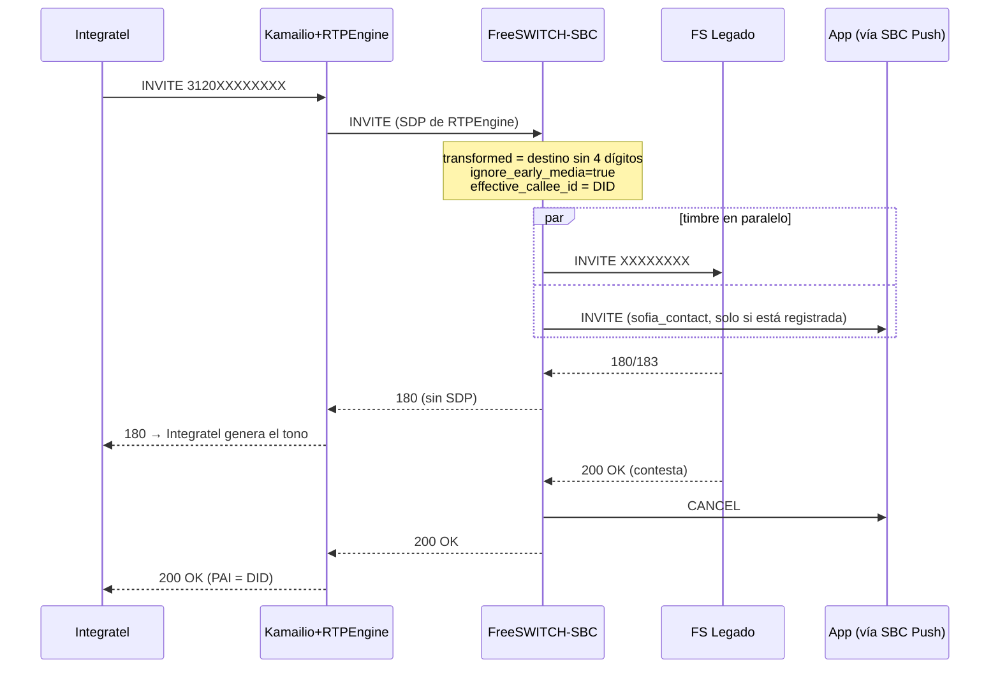
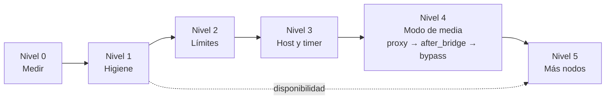

# PRD — Capacidad, escalado y modos de media del nodo FreeSWITCH-SBC

| Campo | Valor |
|---|---|
| Producto | Apolo SBC (repo `ApoloBilling`) |
| Componente | FreeSWITCH-SBC `winproxy` (10.118.0.6), con Kamailio + RTPEngine por delante |
| Fecha del análisis | 2026-10-25 |
| Versión FreeSWITCH | 1.10.12-release (git a88d069, 2024-08-02), 64 bit |
| Estado | Fases de higiene aplicadas / reinicio programado 2026-10-26 00:30 / modos de media pendientes de canario |
| Documentos relacionados | `docs/RTP_FLOW_ARCHITECTURE.md`, `docs/PRD_SBC_Monitoring_Replication.md`, `CLAUDE.md` |
| Skill derivado | `.claude/skills/freeswitch-capacity/` |

> **Cómo leer este documento.** Cada sección técnica termina con un recuadro
> **🧒 Explicado fácil**, escrito para que lo entienda un niño de 11 años. Si
> solo lees esos recuadros, igual te llevas la idea completa.

---

## Índice

1. [Resumen ejecutivo](#1-resumen-ejecutivo)
2. [Contexto y arquitectura](#2-contexto-y-arquitectura)
3. [Cronología del 2026-10-25](#3-cronología-del-2026-10-25)
4. [Problema, objetivos y no-objetivos](#4-problema-objetivos-y-no-objetivos)
5. [Cómo funciona FreeSWITCH por dentro](#5-cómo-funciona-freeswitch-por-dentro)
6. [Mediciones y KPIs](#6-mediciones-y-kpis)
7. [Hallazgos](#7-hallazgos)
8. [Modos de media](#8-modos-de-media)
9. [Revisión del auditor externo](#9-revisión-del-auditor-externo)
10. [Decisiones tomadas](#10-decisiones-tomadas)
11. [Plan gradual (escalera)](#11-plan-gradual-escalera)
12. [Requisitos para el trabajo futuro](#12-requisitos-para-el-trabajo-futuro)
13. [Matriz de pruebas](#13-matriz-de-pruebas)
14. [Riesgos y mitigaciones](#14-riesgos-y-mitigaciones)
15. [Operación: comandos y verificación](#15-operación-comandos-y-verificación)
16. [Skill `freeswitch-capacity`](#16-skill-freeswitch-capacity)
17. [Glosario con explicación fácil](#17-glosario-con-explicación-fácil)
18. [Referencias](#18-referencias)

---

## 1. Resumen ejecutivo

- **Capacidad:** el nodo usa ~10 % de lo que tiene configurado. Pico de 158
  sesiones contra `max-sessions` 1.600; pico de 12 sesiones/s contra 100. El
  límite que manda es `max-sessions`, que equivale a **~780 llamadas
  simultáneas**, unas **10 veces el pico actual**. No hay transcodificación
  (todo PCMA).
- **El problema real es la disponibilidad, no la capacidad:** FreeSWITCH es un
  solo proceso. Cada reinicio corta todas las llamadas en curso (hoy, ~50 por
  reinicio, tres veces).
- **Lo que se aplicó hoy:** `loglevel info`, `mod_cdr_csv` fuera (1,3 GB de CSV
  comprimidos a 315 MB), core DB en RAM y timeouts de RTP (estos dos últimos
  entran con el reinicio programado de las 00:30 del 26-10).
- **Lo que se probó y se descartó:** `mod_timerfd`. Multiplicó por 10 las
  llamadas con lecturas vacías (de 3 % a 30 %) y se revirtió en 10 minutos.
- **Lo que se corrigió en el software:** se retiraron del dashboard indicadores
  que no medían nada real (MOS, pérdida, PDD, jitter); se arreglaron el QPS,
  las consultas lentas y los deadlocks de MariaDB en monitoreo; se arregló el
  chequeo de perfiles del script de mantenimiento; la casilla `bypass_media`
  ahora sí llega al dialplan.
- **Enrutamiento:** todo el tráfico entrante de Integratel pasa por
  FreeSWITCH-SBC (se quitó el canario directo `3157`). El código del enrutamiento
  directo queda listo y con la lista de usuarios de la app sincronizada
  automáticamente.
- **Siguiente paso de capacidad, solo si hiciera falta:** probar `proxy_media`
  en una ruta canaria (quita la dependencia del timer) y después
  `bypass_media_after_bridge`. Para disponibilidad: un segundo nodo FreeSWITCH.

> **🧒 Explicado fácil.** FreeSWITCH es como un edificio por donde pasan todas
> las llamadas. Tiene 1.600 asientos y cada llamada usa 2, así que caben unas
> 780 llamadas. En el momento más lleno de hoy había 158 asientos ocupados: está
> casi vacío. El verdadero problema es que hay **un solo edificio**: si lo
> cierran un momento para arreglarlo, se cortan todas las llamadas que estaban
> adentro. Hoy limpiamos el edificio (sacamos papeles que nadie leía) y
> descubrimos que algunos "termómetros" del tablero no medían nada, así que los
> quitamos.

---

## 2. Contexto y arquitectura

### 2.1 Topología actual (después de los cambios de hoy)

```
                         INTERNET / PSTN
                               │
                    Integratel 10.35.12.68
                               │ SIP
                               ▼
        ┌───────────────────────────────────────────────┐
        │ Kamailio  10.124.193.41:5060 (cara carrier)    │
        │           10.118.0.6:5080   (cara FreeSWITCH)  │
        │  drouting grupo 9000 → regla 2045 (prefijo 31) │
        │  → gw 953 = FreeSWITCH :5062                   │
        └──────────────┬────────────────────────────────┘
          SIP          │            RTP
                       │    ┌────────────────────────────┐
                       │    │ RTPEngine (modo kernel,     │
                       │    │ table=0, xt_RTPENGINE)      │
                       │    │ pública 10.124.193.169      │
                       │    │ interna 10.118.0.6          │
                       │    └─────────────┬──────────────┘
                       ▼                  │ RTP
        ┌───────────────────────────────────────────────┐
        │ FreeSWITCH-SBC 10.118.0.6                      │
        │  perfil external :5062 (desde Kamailio)        │
        │  perfil internal :5060 (registro de la app)    │
        │  dialplan from-kamailio: quita 4 dígitos y     │
        │  hace bridge Legado , app (timbre en paralelo) │
        └──────────┬──────────────────────┬─────────────┘
                   │ SIP+RTP               │ SIP+RTP
                   ▼                       ▼
        FS Legado 10.118.0.4:5060    SBC Push 45.5.68.242:5066 → App Fonowin
```

- Tráfico: ~26.000 llamadas entrantes/día, todas `inbound`.
- Prefijos: `3120`, `3121`, `3122` (90 % del tráfico), `3157`, `3124`.
- El RTP de cada llamada pasa por **dos relés**: RTPEngine (kernel, barato) y
  FreeSWITCH (espacio de usuario, con timer).

### 2.2 Qué hace FreeSWITCH en cada llamada entrante



> **🧒 Explicado fácil.** Cuando alguien llama, la llamada entra por una puerta
> (Kamailio), pasa por el edificio (FreeSWITCH) y el edificio hace sonar **dos
> teléfonos a la vez**: el teléfono normal del cliente (Legado) y la app del
> celular. El primero que contesta se queda con la llamada y al otro se le dice
> "ya no hace falta". La voz viaja por dos "carteros": uno muy rápido
> (RTPEngine) y otro más trabajador (FreeSWITCH).

---

## 3. Cronología del 2026-10-25

| Hora | Evento | Resultado |
|---|---|---|
| 00:30 | Ventana desatendida B+C (`run_window_bc.sh`) | Kamailio OK (fix de PAI en producción). FreeSWITCH: **falso fallo**, el chequeo buscaba espacios y `sofia status` usa tabuladores; reinició dos veces y revirtió (~10 llamadas cortadas + las del segundo reinicio) |
| 09:59 | Reinicio con `mod_timerfd` (`--force-now`) | ~52 llamadas cortadas; verificación OK |
| 10:00–10:08 | Medición de pérdida | Llamadas con >1 % de lecturas vacías: 3 % → 30–67 % |
| 10:01 | Commit del fix del regex en `restart_freeswitch_safe.sh` (ya usado en el reinicio de las 09:59) | `bef3892a` |
| 10:09 | Rollback de timerfd (manteniendo `loglevel info`) | ~40 llamadas cortadas; pérdida vuelve a su valor normal (p50 0,17 %) |
| 10:50 | Quitar `--timerfd` del script de ventana | `77d8a718` |
| 11:02 | Retirar MOS, pérdida, PDD y jitter del dashboard NOC | `857987d1` |
| 11:30 | Retirar la tabla RTCP de la página Monitoreo | `40701ba0` |
| 12:02 | Fix QPS de MariaDB (era total/60 → ~88.850 qps; real ~3,5) | `6c5feb7e` |
| 12:06 | Fix consultas lentas/deadlocks por minuto | `cdfa49b0` |
| 12:47 | `fs_numbers` automático desde `sip_devices` (3.225 números) | `13775b35` |
| 12:54 | Proteger la regla 2070 al guardar una ruta | `fa730b49` |
| 13:03 | Quitar el canario directo `3157`; todo vía FreeSWITCH | `479e1724` |
| 13:17 | `mod_cdr_csv` descargado; core DB en `/dev/shm` configurada | `07b57d49` (instalador) |
| 13:32 | CSV viejos comprimidos (1,3 GB → 315 MB) | `/var/log/freeswitch/cdr-csv-hasta-20261025.tar.gz` |
| 13:56 | La casilla `bypass_media` llega al dialplan | `f9274ce7` |
| 14:00 | `rtp-timeout-sec` 300 / `rtp-hold-timeout-sec` 1800 | `22332d00` |
| 26-10 00:30 | Reinicio programado (core DB + timeouts), con vuelta atrás a la última configuración buena | `apolo-maint-fs-coredb2.timer` |

> **🧒 Explicado fácil.** Fue un día de "taller": de noche un robot intentó
> arreglar el edificio, pero leyó mal un cartel y creyó que estaba roto cuando
> no lo estaba. De día probamos un reloj nuevo para los carteros, salió peor y
> volvimos al viejo en 10 minutos. Después limpiamos papeles inútiles, quitamos
> termómetros falsos del tablero y dejamos programado el último arreglo para la
> madrugada, cuando casi nadie llama.

---

## 4. Problema, objetivos y no-objetivos

### 4.1 Pregunta original
"¿Por qué no puede escalar un nodo FreeSWITCH en un solo servidor y cómo se
mejora: reduciendo módulos, ajustando el código fuente u otra cosa?"

### 4.2 Respuesta corta
Sí escala: miles de llamadas sin tocar código, si no hay transcodificación y el
host tiene un reloj estable. Lo que **no** escala en un solo servidor es la
**disponibilidad**.

### 4.3 Objetivos
- O1. Medir la capacidad real con unidades explícitas y su límite dominante.
- O2. Quitar trabajo inútil por llamada (disco, logs) sin afectar el servicio.
- O3. Detectar indicadores engañosos y retirarlos.
- O4. Definir un plan gradual, de menor a mayor riesgo, con gates y rollback.
- O5. Dejar un método repetible (skill) para analizar otros nodos.

### 4.4 No-objetivos
- Modificar el código fuente de FreeSWITCH.
- Cambiar el modo de media en producción sin canario.
- Facturación (el módulo de billing se retiró el 2026-10-24).

> **🧒 Explicado fácil.** Queríamos saber si el edificio se puede llenar con
> muchas más llamadas. La respuesta es sí; lo que no se puede con un solo
> edificio es que nunca cierre. No vamos a "romper paredes" (tocar el código):
> primero ordenamos y medimos.

---

## 5. Cómo funciona FreeSWITCH por dentro

### 5.1 Los dos cuellos de botella: SIP y RTP

La guía oficial de rendimiento dice que la capacidad depende de dos cuellos de
botella, **SIP y RTP**: llamadas por segundo y llamadas simultáneas.

```
SEÑALIZACIÓN (SIP)                MEDIA (RTP)
──────────────────                ───────────
INVITE, 100, 180, 200, ACK        un paquete cada 20 ms, en cada sentido,
… BYE, 200                        durante toda la llamada
≈ 10 mensajes por llamada         = 50 × 2 sentidos × 2 tramos
(una sola vez)                    = 200 paquetes/s por llamada
```

1.000 llamadas = 200.000 paquetes por segundo, constantes.

### 5.2 Un hilo por sesión y un bucle SIP por perfil

```
               ┌─────────────── proceso freeswitch ───────────────┐
 SIP ─────────►│ mod_sofia: 1 bucle de eventos por perfil          │
               │   (sofia.c: sofia_profile_thread_run/su_root_step)│
               │                                                    │
 RTP tramo A ─►│ hilo sesión A ─ lee ─► escribe en B ───────────────┼──► tramo B
 RTP tramo A ◄─┼─ escribe en A ◄─ lee ─ hilo sesión B ◄─────────────┼─── tramo B
               │                                                    │
               │ core: timer, core DB (SQLite), eventos ESL, logs   │
               └────────────────────────────────────────────────────┘
```

- `switch_core_session_thread_launch()` (`switch_core_session.c` ~1942) da un
  hilo a cada canal. Una llamada = 2 hilos que casi siempre duermen.
- Cada perfil SIP atiende su tráfico en **un bucle** (`sofia.c` ~3130,
  `su_root_step` ~3471–3524): eso pone techo a las llamadas por segundo de cada
  perfil.

### 5.3 El timer (metrónomo)

El envío de RTP sigue al timer (`rtp-timer-name`, por defecto `soft`); la
recepción depende del socket. Si el sistema retrasa el timer (VM, disco,
contención de CPU), **todas** las llamadas tartamudean juntas. En junio de 2026
ya pasó por lecturas de disco de MariaDB; hoy se vio con `mod_timerfd`.

### 5.4 La base de datos interna (core DB)

Cada evento de canal se escribe en `core.db` (SQLite en disco, por defecto). La
configuración oficial de referencia propone `core-db-name=/dev/shm/core.db`
*"for better performance"* (se pierde al reiniciar el equipo, y no importa:
son datos del momento).

### 5.5 Un solo proceso

Todas las llamadas viven en un proceso sin réplica de estado. Si se cae o se
reinicia, se cortan todas. Ningún ajuste lo evita.

> **🧒 Explicado fácil.** Hay dos trabajos: las **cartas** para ponerse de
> acuerdo ("¿hablamos?", "¡sí!", "chau") y la **conversación**, que son 50
> sobrecitos de voz por segundo en cada dirección. Cada asiento tiene su
> **ayudante** que pasa los sobres al otro lado siguiendo un **metrónomo**.
> Los ayudantes casi siempre están dormidos esperando el siguiente "tic", así
> que tener muchos no cansa al edificio. Pero si el metrónomo se atrasa, todos
> los ayudantes se atrasan y las voces se entrecortan. Y como hay un solo
> edificio, si se apaga, se apagan todas las conversaciones.

---

## 6. Mediciones y KPIs

### 6.1 Datos medidos (con unidad y fuente)

| Métrica | Valor | Unidad | Fuente / hora |
|---|---|---|---|
| Llamadas activas | 46 / 61 / 65 | llamadas puenteadas | `show calls count` (14:13 / 13:5x / 14:17) |
| Sesiones activas | 72 / 106 / 105 | canales | `show channels count` / `status` |
| Sesiones por llamada | 1,57–1,74 | sesiones/llamada | cociente (algunos tramos aún timbrando) |
| Pico de sesiones desde el arranque | 158 | sesiones | `status` |
| Pico de sesiones/s | 12 | sesiones/s | `status` (límite 100) |
| CPU de FreeSWITCH | 18,7 % (46 llamadas) · 26 % (65 llamadas) | % de 1 núcleo | `pidstat -u 5–10 s` |
| CPU por llamada | ~0,40 % | de 1 núcleo | cociente |
| Host | 8 vCPU KVM, 9,9 GB RAM, idle 94–95 %, iowait 0 %, steal 0 % | — | `vmstat` |
| Hilos / memoria FS | 122–178 / 158–225 MB | — | `/proc/PID` |
| Códec | PCMA en todos los tramos | — | `show channels` |
| DTMF (telephone-event) | **97** lado Integratel/RTPEngine · **101** lado Legado | payload type | `uuid_dump` |
| ptime | 20 ms en ambos lados | ms | `uuid_dump` |
| Registros de la app | 28–29, todos desde 45.5.68.242:5066 | registros | `show registrations` |
| Media de la app | `c=IN IP4 45.5.68.242` (relé del SBC Push, IP pública) | — | SDP en `freeswitch.log` |

### 6.2 Techos y límite dominante

| Techo | Cálculo | Llamadas |
|---|---|---|
| `max-sessions` | 1.600 / ~2,06 sesiones por llamada (2 + 5,6 % con timbre en paralelo) | **~780** ← manda |
| Puertos RTP | (32768 − 20002) / 2 = 6.383 tramos / 2,06 | ~3.100 |
| CPU (estimación lineal) | 8 × 0,70 núcleos / 0,0041 núcleos por llamada | ~1.360 |
| CPS | 100 sesiones/s ≈ 48 llamadas/s | — (pico actual 12 sesiones/s) |

La estimación de CPU es lineal: en una VM lo primero que fallaría es la
precisión del timer, antes que la CPU.

> **🧒 Explicado fácil.** Contamos con cuidado: una **llamada** usa 2 asientos
> (3 mientras suenan dos teléfonos). Hay 1.600 asientos, así que caben unas
> 780 llamadas; hoy, en el peor momento, se usaron 158 asientos. Las otras
> "paredes" (los puertos para la voz y la fuerza de los ayudantes) están todavía
> más lejos. O sea: sobra espacio, unas 10 veces lo que se usa.

---

## 7. Hallazgos

### H1. `mod_timerfd` empeoró el audio medido
| Fase | Llamadas | p50 lecturas vacías | p90 | Llamadas >1 % |
|---|---|---|---|---|
| Sin timerfd (09:30–09:59) | 436 | 0,13 % | 0,53 % | 3 % |
| **Con timerfd** (09:59–10:09) | 177 | 0,46 % | 2,81 % | **30 %** |
| Rollback (10:09–10:16) | 88 | 0,17 % | 0,60 % | 5 % |

Decisión: revertido; no reactivar sin investigar (`77d8a718`).

> **🧒 Explicado fácil.** Probamos un metrónomo nuevo "más preciso" y los
> ayudantes empezaron a encontrar la bandeja vacía 10 veces más seguido. Lo
> devolvimos y todo volvió a la normalidad. Moraleja: **todo cambio se mide
> antes y después**.

### H2. Indicadores que no medían nada real
- **MOS de FreeSWITCH** (`switch_rtp.c` `do_mos`, ~1575–1609):
  `R = int((recibidos − flaws) / recibidos × 100)` y
  `MOS = 1 + 0,035·R + 0,000007·R·(R−60)·(100−R)`. Sin huecos de secuencia da
  4,50 exacto (88,4 % de las llamadas); bajar de 3,6 requiere ~30 % de paquetes
  con problemas. No considera códec, retardo ni jitter.
- **"Pérdida"** = `in_skip_packet_count`: sube cuando FreeSWITCH lee y no hay
  paquete y entonces genera ruido de confort (`switch_rtp.c` ~7826). Incluye
  silencios y desfases del timer; **no es pérdida de red** (la real sería
  `in_flaw_total`).
- **PDD**: INVITE → primer 18x del siguiente salto, cuantizado al reloj de
  20 ms (valores 0/19/20 ms). Legado responde al instante; no es el PDD de la
  red de destino.
- **MOS/jitter/RTT/pérdida de RTPEngine**: en modo kernel el RTCP se reenvía sin
  analizarse; los contadores no se mueven.

Acción: retirados del dashboard (`857987d1`) y de Monitoreo (`40701ba0`). El
motor sigue guardando `pdd_ms`, `mos` y `rtp_loss_pct` en los CDRs.

> **🧒 Explicado fácil.** Teníamos un termómetro que **solo llega hasta 4,5** y
> casi siempre marca 4,5: nunca te avisa si alguien tiene un poquito de fiebre.
> Otro contaba "cartas perdidas", pero en realidad contaba las veces que el
> cartero encontró el buzón vacío, aunque fuera porque nadie escribió. Si un
> termómetro miente, es mejor no colgarlo en la pared.

### H3. Monitoreo de MariaDB con fórmulas equivocadas
- QPS = `Questions / 60` (total desde el arranque) → mostraba ~88.850; real
  ~3,5. Ahora es la diferencia entre muestras (`6c5feb7e`).
- Consultas lentas y deadlocks "por minuto" eran totales acumulados; con 5
  consultas lentas en 22 días, el estado iba a quedar "degraded" para siempre.
  Ahora son por minuto (`cdfa49b0`).

### H4. Escrituras a disco por llamada
`mod_cdr_csv` (1,3 GB, redundante con los CDRs en PostgreSQL), `loglevel debug`
(~1 GB/día) y core DB en disco. Ver §11, nivel 1.

> **🧒 Explicado fácil.** Había un empleado que copiaba cada llamada en un
> cuaderno de papel que nadie leía (porque la computadora ya la guardaba), y
> un periodista que anotaba cada palabra de cada conversación. Les dimos el
> día libre. Y la lista de visitantes del día ahora se escribe en una pizarra
> (rápida) en vez de tallarla en piedra.

### H5. Llamadas muertas sin detección completa
- Perfiles `internal`/`external` sin `rtp-timeout-sec` (ya agregado,
  `22332d00`, entra a las 00:30).
- Session timers **ya activos** (`enable-timer=true`, `session-timeout=1800`),
  efectivos solo si el otro extremo soporta Session-Expires.
- Kamailio: `default_timeout=21600` (6 h), `send_bye=0`, sin keepalive de
  diálogo. RTPEngine `timeout=60` libera sus recursos pero **no envía BYE**.
- Evidencia actual: 0 canales con más de 2 h; en 7 días, 16 de 198.000 CDRs
  duraron más de 2 h (máximo 4 h 02 min). Pendiente revisarlos.

> **🧒 Explicado fácil.** A veces alguien se va sin colgar y el asiento queda
> ocupado. Ahora, si una línea está **5 minutos en silencio total**, el
> edificio la cuelga y libera el asiento. Además, cada 30 minutos pregunta
> "¿siguen ahí?".

### H6. Fallas en los scripts de mantenimiento
- Regex del chequeo de perfiles con espacios vs tabuladores (`bef3892a`).
- El rollback restauraba la configuración ya modificada: el reinicio de las
  00:30 ahora vuelve a la última configuración buena conocida
  (`/root/freeswitch-conf-20261025-131740-coredb.tgz`) solo si FreeSWITCH llegó
  a reiniciarse.

### H7. Enrutamiento directo y usuarios de la app
- `fs_numbers` era una lista manual de 25 números; faltaban 13 de los 29
  usuarios registrados. Ahora se sincroniza desde `sip_devices` (3.225) cada
  60 s y en cada alta/baja (`13775b35`).
- Guardar la ruta "DID 3122" habría borrado la regla de desvío 2070 (`fa730b49`).
- Decisión del usuario: demasiada complejidad → canario retirado; todo vía
  FreeSWITCH (`479e1724`).

### H8. La casilla `bypass_media` no hacía nada
La columna y la casilla existían, pero el generador no escribía la variable.
Corregido (`f9274ce7`); ninguna ruta la tiene activa.

---

## 8. Modos de media

### 8.1 Los cuatro modos

```
NORMAL (hoy)
Integratel ⇄ RTPEngine ⇄ [FreeSWITCH: timer + jitter + copia] ⇄ Legado

PROXY_MEDIA
Integratel ⇄ RTPEngine ⇄ [FreeSWITCH: reenvía sin abrir, SIN timer] ⇄ Legado

BYPASS_MEDIA_AFTER_BRIDGE
mientras timbra:  igual que NORMAL
al contestar:     re-INVITE → Integratel ⇄ RTPEngine ⇄ Legado   (FS fuera)

BYPASS_MEDIA
Integratel ⇄ RTPEngine ⇄ Legado      FreeSWITCH: solo SIP
```

| Modo | Definición oficial (resumen) | Qué limita a FreeSWITCH | Qué se pierde |
|---|---|---|---|
| Normal | FS termina el RTP de cada tramo | CPU por paquete, timer, puertos, `max-sessions` | — |
| Proxy | reenvía sin decodificar; sigue ocupando puertos; sin transcodificación | puertos, hilos, `max-sessions` | transcodificación, grabación/playback (cuelga), DTMF en banda, traducción de payload types |
| Bypass after bridge | maneja la media hasta contestar y luego sale con re-INVITE | señalización, `max-sessions` | lo mismo que bypass después de contestar; depende del re-INVITE |
| Bypass | reescribe el SDP; el RTP no toca el host | CPS y `max-sessions` | todo control de media; timeout de RTP en FS |

Verificado en el código: con `proxy_media` la sesión RTP se crea **sin
`USE_TIMER`** (`switch_core_media.c` ~8714–8717; `switch_rtp.c` ~3073), así que
elimina la dependencia del timer que falló en H1.

### 8.2 Compatibilidad con este sistema

| Ítem | Estado | Evidencia |
|---|---|---|
| Códec común | ✅ | PCMA en todos los tramos |
| ptime | ✅ | 20 ms en ambos lados |
| DTMF payload type | ⚠️ **97 vs 101** | En proxy/bypass se negocia de punta a punta; con after_bridge el re-INVITE obliga a Legado a cambiar de PT en plena llamada |
| re-INVITE vía Kamailio/RTPEngine | ✅ (config) / ⏳ (prueba) | `RELAY` activa `MANAGE_BRANCH` (`RTPENGINEOFFER`) y `MANAGE_REPLY` (`RTPENGINEANSWER`) también dentro del diálogo (`kamailio.cfg` ~1863–1867) |
| Latching de RTPEngine con timbre en paralelo | ⚠️ riesgo en bypass puro | `port-latching`; si Legado manda RTP temprano y gana la app → audio en un sentido |
| NAT / alcance de la app | ⚠️ | El relé de media de la app es **público** (45.5.68.242); RTPEngine debe alcanzarlo por la interfaz correcta |
| Ringback | = hoy | Hoy tampoco lo genera FreeSWITCH (`ignore_early_media`, sin `ringback`); Integratel genera el tono con el 180 |
| Música en espera | ⚠️ | Se pierde salvo `media-option=resume-media-on-hold` |
| Limpieza de llamadas muertas | ⚠️ en bypass | FS no ve RTP; depende de session timers y del proxy |
| Kernel forwarding de RTPEngine | ✅ | `xt_RTPENGINE` cargado, `/proc/rtpengine/0/list` con flujos |

> **🧒 Explicado fácil.** Hay cuatro formas de pasar la voz:
> **Normal**: el ayudante abre cada sobre, lo mira y lo pasa siguiendo el
> metrónomo. **Proxy**: lo pasa **sin abrirlo y sin metrónomo**, apenas llega.
> **Bypass**: el edificio presenta a las dos personas y después hablan **por
> una ventana**, sin pasar por el edificio. **Bypass después de contestar**: el
> edificio lleva la voz mientras suena el teléfono y abre la ventana cuando
> alguien atiende. El cuidado está en que, al abrir la ventana, la voz no se
> vaya a la persona equivocada y que los dos hablen el mismo "idioma de
> teclas" (el DTMF: unos usan el número 97 y otros el 101).

---

## 9. Revisión del auditor externo

| # | Observación | Veredicto | Evidencia |
|---|---|---|---|
| 1 | Se mezclaron canales y llamadas | Correcta en parte | 63 llamadas = 126 sesiones; "67/67 PCMA" eran canales de otra muestra |
| 2 | 3 sesiones con timbre en paralelo | Correcta, exagerada | El tercer tramo existe solo con la app registrada (~5,6 %); techo ~780, no 533 |
| 3 | La falta de detección de llamadas muertas ya existe hoy | Correcta en parte | Faltaba `rtp-timeout-sec`; los session timers ya estaban activos |
| 4 | RTPEngine no envía BYE | Correcta | Corregido en el análisis |
| 5 | `proxy_media` subestimado | Correcta | Sin `USE_TIMER` en el código |
| 6 | Falta la app en el re-INVITE | Correcta | El re-INVITE también va al SBC Push |
| 7 | Kamailio debe pasar el re-INVITE por RTPEngine | Ya cubierto | `RELAY` → `MANAGE_BRANCH`/`MANAGE_REPLY` |
| 8 | Latching con timbre en paralelo | Correcta, seria para bypass puro | `port-latching` |
| 9 | Payload types | Correcta, confirmada | 97 vs 101 |
| 10 | Silencio al timbrar | No es riesgo nuevo | Hoy ya funciona así |
| 11 | ¿El SBC Push ancla la media? | Sí, pero en IP pública | `c=45.5.68.242` |
| 12 | Kernel forwarding | Verificado | `/proc/rtpengine/0/list` |

---

## 10. Decisiones tomadas

| ID | Decisión | Motivo |
|---|---|---|
| D1 | No modificar el código fuente de FreeSWITCH | Límites de diseño; un fork pierde actualizaciones y parches |
| D2 | Revertir `mod_timerfd` | Regresión medida (H1) |
| D3 | Retirar MOS, pérdida, PDD y jitter de las pantallas | No miden nada real (H2) |
| D4 | Todo el tráfico entrante vía FreeSWITCH-SBC | Simplicidad operativa; el código directo queda listo |
| D5 | Higiene: `loglevel info`, sin `mod_cdr_csv`, core DB en RAM, timeouts RTP | Quitar trabajo por llamada sin riesgo funcional |
| D6 | No cambiar el modo de media hoy | Margen ~10×; requiere canario y matriz de pruebas |
| D7 | Para disponibilidad, priorizar un segundo nodo antes que modos de media | El problema real es el proceso único |

---

## 11. Plan gradual (escalera)

| Nivel | Cambio | Estado | Gate | Rollback |
|---|---|---|---|---|
| 0 | Medir con unidades; retirar indicadores engañosos | ✅ hecho | Límite dominante declarado | — |
| 1 | `loglevel info` | ✅ 10-25 10:09 | sin errores nuevos | `fsctl loglevel debug` |
| 1 | `mod_cdr_csv` fuera | ✅ 10-25 13:17 | `Master.csv` no crece; CDRs en PG | `load mod_cdr_csv` + descomentar |
| 1 | core DB en `/dev/shm` | ⏳ 10-26 00:30 | `/dev/shm/core.db` existe; perfiles RUNNING; registros recuperados | backup known-good automático |
| 1 | `rtp-timeout-sec` 300 / 1800 | ⏳ 10-26 00:30 | ningún corte con `MEDIA_TIMEOUT` en llamadas sanas | quitar los 2 params + reinicio |
| 1 | Revisar 16 CDRs > 2 h | ⏳ | saber si hay fantasmas | — |
| 1 | Quitar módulos sin uso | ⏳ | grep del dialplan sin referencias activas | volver a cargar |
| 2 | Límites al tráfico | ✅ sobrado | sin "Throttle"/"Max Sessions" | — |
| 3 | Host/timer | ⏸ no hace falta | — | — |
| 4a | `proxy_media` canario | ⏳ futuro | matriz §13 verde 1 día; DTMF OK | quitar variable |
| 4b | `bypass_media_after_bridge` canario | ⏳ futuro | re-INVITE OK con Integratel, Legado y app | quitar variable |
| 4c | `bypass_media` | ⏳ futuro | latching resuelto | quitar variable |
| 5 | Segundo nodo FreeSWITCH | ⏳ propuesta | reiniciar un nodo sin impacto en llamadas nuevas | sacar el nodo del dispatcher |



> **🧒 Explicado fácil.** Es como subir una escalera: primero los escalones
> fáciles y seguros (ordenar, limpiar), y solo si hace falta, los más altos
> (cambiar cómo viaja la voz o construir otro edificio). En cada escalón
> miramos si mejoró antes de subir al siguiente, y siempre guardamos el mapa
> viejo en el bolsillo por si hay que volver.

---

## 12. Requisitos para el trabajo futuro

### Funcionales
- **RF1.** Selector de modo de media por ruta entrante con valores `normal`,
  `proxy`, `bypass_after_bridge`, `bypass` (migración: reemplazar el booleano
  `bypass_media`; generador en `sync_inbound_routes_to_freeswitch`).
- **RF2.** Mostrar en la interfaz el modo efectivo de cada ruta y advertir las
  funciones que se pierden (§8.1).
- **RF3.** Métrica de pérdida real basada en `rtp_audio_in_flaw_total`
  (columna nueva en `cdrs`, migración 022) en lugar de `skip_packet_count`.
- **RF4.** Panel de capacidad: sesiones/llamadas, sesiones por llamada, pico vs
  `max-sessions`, CPS vs límite, CPU por llamada (datos del colector).
- **RF5.** Segundo nodo FreeSWITCH detrás de Kamailio (`dispatcher` con OPTIONS)
  y registro de la app en Kamailio con `Path`.

### No funcionales
- **RNF1.** Ningún cambio de timer o de modo de media sin línea base, gate y
  rollback documentados (plantilla del skill).
- **RNF2.** Reinicios de FreeSWITCH solo en ventana de bajo tráfico (≤10
  llamadas) y con backup de la última configuración buena tomado **antes** de
  editar.
- **RNF3.** Toda verificación automática se prueba contra la salida real antes
  de usarla en una ventana desatendida.
- **RNF4.** Indicadores en pantalla solo si miden lo que dicen; si no, se
  retiran o se renombran.

---

## 13. Matriz de pruebas

Para cada modo (proxy, after_bridge, bypass) en una ruta canaria:

| # | Caso | Esperado |
|---|---|---|
| T1 | Contesta Legado | audio en ambos sentidos en < 1 s |
| T2 | Contesta la app (SBC Push) | ídem; sin audio en un sentido |
| T3 | Suenan ambos, contesta el segundo | audio correcto (latching) |
| T4 | El llamante cuelga timbrando | CANCEL a ambos tramos; CDR sin respuesta |
| T5 | Ocupado / rechazo | causa correcta hacia Integratel |
| T6 | DTMF en ambos sentidos | dígitos recibidos (PT 97/101) |
| T7 | Espera / retomar | audio vuelve; música si se configuró |
| T8 | re-INVITE desde Integratel | sin corte de audio |
| T9 | Silencio total > 300 s (normal/proxy) | corte con `MEDIA_TIMEOUT` |
| T10 | BYE desde cada lado | diálogo cerrado en Kamailio y FS |
| T11 | Duración del CDR | coincide con la real |

> **🧒 Explicado fácil.** Antes de abrir un camino nuevo para todos, mandamos
> por ahí a un grupo chiquito y revisamos una lista: ¿se escuchan los dos?, ¿si
> uno cuelga se corta bien?, ¿funcionan las teclas del teléfono?, ¿qué pasa si
> alguien queda en espera? Solo si todo sale bien, abrimos el camino para más
> gente.

---

## 14. Riesgos y mitigaciones

| Riesgo | Probabilidad | Impacto | Mitigación |
|---|---|---|---|
| El reinicio de las 00:30 deja FS caído | Baja | Alto | Gate ≤10 llamadas; verificación; vuelta atrás a known-good; aviso en syslog |
| `rtp-timeout-sec` corta llamadas legítimas en silencio largo | Baja | Medio | 300 s es amplio; en espera 1800 s; revisar causas `MEDIA_TIMEOUT` al día siguiente |
| core DB en RAM se pierde al reiniciar el equipo | Segura | Nulo | Son datos del momento; FS la recrea |
| DTMF roto en proxy/bypass (97 vs 101) | Media | Medio | Prueba T6 obligatoria |
| Audio en un sentido por latching en bypass puro | Media | Alto | Empezar por after_bridge; flags de RTPEngine |
| Reinicio de FS corta todas las llamadas | Segura en cada reinicio | Alto | Ventanas; a futuro, segundo nodo |
| Volver a medir mal (unidades) | Media | Medio | Colector + fórmulas del skill |

---

## 15. Operación: comandos y verificación

```bash
# Snapshot de capacidad (solo lectura)
.claude/skills/freeswitch-capacity/scripts/collect_fs_capacity.sh -s 10 -o /tmp/fs-capacity.txt

# Después de las 00:30 del 26-10
journalctl -t apolo-maint --since "2026-10-26 00:25"
ls -l /dev/shm/core.db
ls -t /var/log/apolo-maint-freeswitch-*.log | head -1 | xargs cat
fs_cli -x 'sofia status' ; fs_cli -x 'show registrations count'

# Rollback manual a la configuración buena conocida
tar xzf /root/freeswitch-conf-20261025-131740-coredb.tgz -C /
chown -R freeswitch:freeswitch /etc/freeswitch/autoload_configs /etc/freeswitch/sip_profiles
systemctl restart freeswitch     # corta las llamadas en curso

# Recrear el canario directo (si algún día se retoma)
mysql kamailio < /root/dr_rule_2071_canary-20261025-130323.sql && kamcmd drouting.reload
```

---

## 16. Skill `freeswitch-capacity`

Ubicación: `.claude/skills/freeswitch-capacity/`.

```
freeswitch-capacity/
├── SKILL.md                         flujo: recolectar → KPIs → diagnóstico → escalera → informe
├── scripts/collect_fs_capacity.sh   snapshot de solo lectura (config, carga, host, trampas)
├── references/
│   ├── kpis-and-formulas.md         unidades, fórmulas, techos, métricas engañosas
│   ├── freeswitch-internals.md      por qué existen los límites (con líneas del código)
│   ├── media-modes.md               normal/proxy/after_bridge/bypass, checklist y matriz
│   ├── recommendation-ladder.md     niveles 0–5 con gates y rollback
│   ├── lessons-learned.md           15 trampas reales de este nodo
│   └── kid-explanations.md          reglas y biblioteca de analogías
└── evals/                           2 casos (nodo real y nodo saturado con transcodificación)
```

Uso: pedirle a Claude, por ejemplo, *"analiza la capacidad de este
FreeSWITCH"* o *"¿cuántas llamadas aguanta fs-pbx-02?"*. El skill corre el
colector (o pide su salida), calcula los KPIs con unidades y entrega un informe
con recuadros "Explicado fácil".

---

## 17. Glosario con explicación fácil

| Término | Técnico | 🧒 Fácil |
|---|---|---|
| SIP | Protocolo de señalización de llamadas | Las cartas para ponerse de acuerdo |
| RTP | Protocolo que transporta la voz | Los sobrecitos de voz, 50 por segundo |
| Sesión / canal | Un tramo de llamada dentro de FreeSWITCH | Un asiento ocupado |
| Llamada | Dos tramos unidos (A y B) | Dos asientos, uno para cada persona |
| CPS | Sesiones nuevas por segundo | Cuánta gente nueva deja pasar el portero por segundo |
| `max-sessions` | Máximo de canales simultáneos | Cantidad de asientos del edificio |
| Transcodificación | Convertir audio entre códecs | Traducir cada sobre a otro idioma |
| Timer | Reloj que marca el envío cada 20 ms | El metrónomo de los ayudantes |
| core DB | Base SQLite con el estado de los canales | La lista de visitantes del día |
| Kamailio | Proxy SIP delante de FreeSWITCH | La recepción que manda a cada visitante a su lugar |
| RTPEngine | Relé de media en el kernel | La ventana rápida por donde pasa la voz |
| Bypass | La voz no pasa por FreeSWITCH | Hablar por la ventana, sin entrar al edificio |
| Proxy media | FS reenvía sin abrir ni usar timer | Pasar el sobre cerrado apenas llega |
| Latching | RTPEngine fija el origen del audio | La ventana recuerda la primera cara que vio |
| DTMF / telephone-event | Tonos de teclado en RTP (RFC 4733) | El "idioma de las teclas" (97 o 101) |
| Canario | Prueba con poco tráfico real | Mandar un grupo chico primero |
| Rollback | Volver a la configuración anterior | Guardar el mapa viejo en el bolsillo |

---

## 18. Referencias

### Documentación oficial de FreeSWITCH
- Performance Testing and Configurations — https://developer.signalwire.com/freeswitch/FreeSWITCH-Explained/Configuration/Performance-Testing-and-Configurations
- XML Switch Configuration — https://developer.signalwire.com/freeswitch/FreeSWITCH-Explained/Configuration/XML-Switch-Configuration_13173223 (espejo: https://www.freeswitch.org/confluence/display/FREESWITCH/XML+Switch+Configuration)
- Media Handling (repositorio oficial de docs) — https://github.com/signalwire/freeswitch-docs/blob/main/docs/media/media-handling.mdx
- Bypass Media Overview — https://developer.signalwire.com/freeswitch/FreeSWITCH-Explained/Codecs-and-Media/Bypass-Media-Overview/
- Proxy Media — https://developer.signalwire.com/freeswitch/FreeSWITCH-Explained/Configuration/Proxy-Media_13173588
- Variables: `bypass_media` — https://developer.signalwire.com/freeswitch/Channel-Variables-Catalog/bypass_media_16353339 · `bypass_media_after_bridge` — https://developer.signalwire.com/freeswitch/Channel-Variables-Catalog/bypass_media_after_bridge_16353343 · `proxy_media` — https://developer.signalwire.com/freeswitch/Channel-Variables-Catalog/proxy_media_16353349/
- Configuración vanilla v1.10.12 — https://github.com/signalwire/freeswitch/blob/v1.10.12/conf/vanilla/autoload_configs/switch.conf.xml

### Código fuente FreeSWITCH v1.10.12 (líneas aproximadas)
- `src/switch_core_session.c` — `switch_core_session_thread_launch` (~1942)
- `src/mod/endpoints/mod_sofia/sofia.c` — `sofia_profile_thread_run` (~3130), `su_root_step` (~3471–3524), `rtp-timeout-sec` (~5324)
- `src/mod/endpoints/mod_sofia/sofia_glue.c` — aplica `rtp_timeout_sec` del perfil (~185–186)
- `src/switch_rtp.c` — `do_mos` (~1575–1609), `skip_packet_count` (~7826), modo proxy/UDPTL sin timer (~3066–3113)
- `src/switch_core_media.c` — proxy media sin `USE_TIMER` (~8714–8717), estadísticas RTP exportadas (~1860–1883)
- `src/switch_ivr_originate.c` — ringback y early media en modos proxy (~999, ~3852–3863)
- `src/switch_channel.c` — marca de `progress`/`progress_media` (~3486–3555)

### Otras fuentes
- switchio, FreeSWITCH configuration and deployment — https://switchio.readthedocs.io/en/latest/fsconfig.html
- freeswitch-users, Performance Testing (2008) — https://lists.freeswitch.org/pipermail/freeswitch-users/2008-July/032342.html
- FreeSWITCH wiki, Bypass media — https://wiki.freeswitch.org/wiki/Bypass_media
- Kolmisoft M2, Bypass Media — https://wiki.kolmisoft.com/index.php/M2_Bypass_Media

### Repositorio (archivos y commits)
- `scripts/maint/restart_freeswitch_safe.sh`, `scripts/maint/run_window_bc.sh`, `scripts/install_server.sh`
- `config/freeswitch/sip_profiles/{internal,external}.xml`, `config/kamailio/kamailio.cfg`
- `rust-backend/crates/apolo-api/src/handlers/{stats.rs,unified_routing.rs,sip_device.rs,provisioning.rs}`
- `rust-billing-engine/src/esl/event.rs`, `backend/app/monitoring/{service.py,rates.py}`, `monitoring_service.py`
- `frontend/src/components/noc/QualityPanel.tsx`, `frontend/src/pages/Monitoring/MonitoringDashboard.tsx`
- Commits: `bef3892a`, `77d8a718`, `857987d1`, `40701ba0`, `6c5feb7e`, `cdfa49b0`, `13775b35`, `fa730b49`, `479e1724`, `07b57d49`, `f9274ce7`, `22332d00`
